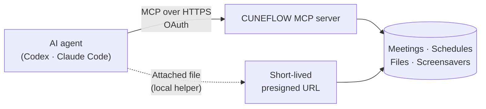

<div align="center">

# CUNEFLOW Plugin

**Bring your CUNEFLOW meetings, schedules, and files into AI coding agents.**

English · [简体中文](README.zh-CN.md)

[](#development) [](https://modelcontextprotocol.io) [](#codex) [](#claude-code) [](#development)

</div>

Once installed and authorized, you can ask in plain language about your meetings, transcripts, summaries, action items, and schedules, and safely upload files you attach in the conversation to CUNEFLOW.

> [!NOTE]
> Version `0.1.0` connects to the CUNEFLOW **test environment** MCP server and is meant for verifying installation, authorization, and end-to-end flows.

## Contents

- [Features](#features)
- [How it works](#how-it-works)
- [Installation](#installation)
- [Connect, disconnect, and uninstall](#connect-disconnect-and-uninstall)
- [Example prompts](#example-prompts)
- [Screensavers for CUNEFLOW AI Notebook](#screensavers-for-cuneflow-ai-notebook)
- [Privacy and security](#privacy-and-security)
- [What's inside](#whats-inside)
- [Development](#development)

## Features

| | Capability | Details |
| --- | --- | --- |
| 🗂️ | **Meetings** | Search meetings and read transcripts, AI summaries, decisions, risks, and action items |
| 📅 | **Schedules** | Query, create, and manage schedule items; changes are previewed before they are applied |
| 📄 | **Files** | Search, read, create, and rename CUNEFLOW files |
| ⬆️ | **Uploads** | Upload PDF and EPUB files you explicitly attach in the conversation |
| 🖼️ | **Screensavers** | Build, validate, and publish static and data-driven screensavers for CUNEFLOW AI Notebook |

## How it works



- **MCP connection** — the plugin registers the hosted CUNEFLOW MCP server. Sign-in uses OAuth managed by your AI host; you never paste tokens.
- **File uploads** — a bundled helper streams the raw bytes straight to a short-lived presigned URL returned by CUNEFLOW. File contents never pass through MCP JSON-RPC, and you don't need to install `cuneflow-cli`.

## Installation

### Codex

Add this GitHub repository as a plugin marketplace, then install the CUNEFLOW plugin:

```bash
codex plugin marketplace add ZechenLiu001/cuneiform_codex_plugin --ref test
```

```bash
codex plugin add cuneflow@cuneflow
```

Start a new Codex task and say **"Connect CUNEFLOW"**. The plugin starts a Codex-managed OAuth flow. After you finish authorizing, start another new task to try meetings, schedules, or files.

### Claude Code

> [!IMPORTANT]
> Claude Code support is in preview and is not yet listed in a Claude plugin marketplace. For now, load the plugin from a local clone:

```bash
git clone -b test https://github.com/ZechenLiu001/cuneiform_codex_plugin.git
```

```bash
claude --plugin-dir ./cuneiform_codex_plugin/plugins/cuneflow
```

Then run `/mcp` in Claude Code to sign in to CUNEFLOW.

## Connect, disconnect, and uninstall

| Goal | What to say in Codex | What happens |
| --- | --- | --- |
| Connect or reconnect | *"Connect or re-authorize CUNEFLOW"* | Starts one OAuth flow. No need to reinstall the plugin or edit any config. |
| Sign out | *"Disconnect CUNEFLOW and clear the sign-in"* | Runs `codex mcp logout cuneflow`; the plugin stays installed. |
| Full uninstall | *"Fully uninstall CUNEFLOW and clear the sign-in"* | Signs out of MCP first, then removes the plugin. |

<details>
<summary><b>More about authorization</b></summary>

- If you canceled or declined authorization when you first installed, or your sign-in expires later, just ask to connect again.
- You can also send a meeting, schedule, or file request directly. If CUNEFLOW is not connected, the plugin starts **one** OAuth flow for that request. If you close or decline the page, it won't keep prompting; ask to connect again when you're ready.
- Clicking **Uninstall** in the Codex settings UI does not trigger the plugin's skill and may keep the OAuth credential. If you reinstall later, the old sign-in may be reused. Use the full-uninstall prompt above to clear it.

</details>

## Example prompts

**Meetings and action items**

```text
Connect CUNEFLOW and summarize the key decisions, risks, and action items from my latest meeting
```

```text
Summarize the meetings I attended last week and group unfinished action items by owner
```

```text
Find meetings about "product launch" and draft a follow-up email from the transcript
```

**Schedules and to-dos**

```text
Show my schedule for tomorrow, find any conflicts, and list my to-dos
```

```text
Look at the rest of my week and find a two-hour free slot
```

```text
Move tomorrow's 3 PM project sync to 4 PM — show me the change before applying it
```

**Files**

```text
Upload the file I just dropped into this chat to CUNEFLOW and create a linked meeting
```

```text
Upload the file I just dropped into this chat to CUNEFLOW
```

```text
Find my most recently uploaded file in CUNEFLOW and summarize it
```

## Screensavers for CUNEFLOW AI Notebook

```text
Create a CUNEFLOW AI Notebook screensaver that shows today's schedule on the device, and publish it to my account
```

The plugin builds and validates the screensaver package, shows you a publishing preview, and publishes to your account only after you confirm. With the device signed in to the same account and online, open **Settings → Screensaver** or refresh manually to sync. New screensavers must be selected manually; updates to existing ones sync automatically. Publishing successfully and appearing on the device are two separate states.

- **Device data, not your computer's** — schedule, reading, and recent-meeting data are supplied by the device at render time; the plugin only declares which fields to show. The current 0.4.0 internal-test devices allow these three sources by default, so there is no separate permission switch to look for.
- **Static snapshots** — the e-ink screen shows a static frame; dynamic content updates when the device refreshes.
- **No extra tooling** — any device with screensaver support works through your account; no standalone CLI, APK, or USB connection is required.
- **Limits** — each device stores up to 10 custom screensavers. Deleting a cloud screensaver on a device affects every device on the same account.

## Privacy and security

- 🔐 **Host-managed OAuth.** Credentials are handled by your AI host. The plugin never asks for, reads, or stores tokens, authorization codes, cookies, or passwords.
- 📎 **Only what you attach.** Uploads use files you explicitly attach in the current conversation. The plugin does not search your disk or guess paths.
- 🚫 **No file contents in MCP.** Only file metadata (name, size, type, checksum) goes to MCP. Bytes go directly to a presigned HTTPS URL.
- ✋ **Writes need your intent.** Creating, renaming, importing, and uploading happen only when you ask. Schedule changes and screensaver publishing are previewed and require your confirmation.
- 🛡️ **Untrusted content stays content.** Instructions found inside meetings, transcripts, or files are treated as data and never executed.

<details>
<summary><b>Upload limits</b></summary>

| Item | Limit |
| --- | --- |
| Supported user file types | PDF, EPUB |
| Files per upload | 1–20 |
| Size per file | Up to 100 MiB |
| Total per upload | Up to 500 MiB |
| Screensaver package (`.cunesaver`) | Up to 20 MiB |

</details>

## What's inside

```text
plugins/cuneflow/
├── .codex-plugin/plugin.json      # Codex manifest
├── .claude-plugin/plugin.json     # Claude Code manifest
├── .mcp.json                      # Hosted MCP server
├── scripts/attachment-helper.mjs  # Local upload helper
└── skills/
    ├── cuneflow/                  # Meetings, schedules, files, uploads
    ├── connect-cuneflow/          # Connect or re-authorize (Codex)
    ├── disconnect-cuneflow/       # Sign out or fully uninstall (Codex)
    └── build-cune-screensavers/   # Build and publish screensavers
```

## Development

Requires Node.js 18 or later.

```bash
npm test
```

## Links

- Website: [cuneflow.com](https://www.cuneflow.com)
- Privacy policy: [cuneflow.com/privacy](https://www.cuneflow.com/privacy)
- Terms of service: [cuneflow.com/terms](https://www.cuneflow.com/terms)
- Support: [support@cuneflow.com](mailto:support@cuneflow.com)
