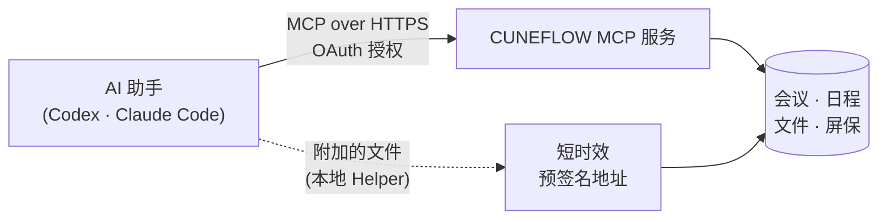

<div align="center">

# CUNEFLOW 插件

**在 AI 编程助手里直接使用 CUNEFLOW 的会议、日程和文件。**

[English](README.md) · 简体中文

[](#开发) [](https://modelcontextprotocol.io) [](#codex) [](#claude-code) [](#开发)

</div>

安装并授权后，可以通过自然语言查询会议、转写、纪要、行动项和日程，也可以把当前对话中附加的本地文件安全上传到 CUNEFLOW。

> [!NOTE]
> 当前 `0.1.0` 版本连接 CUNEFLOW **测试环境** MCP，用于安装、授权和功能链路验证。

## 目录

- [功能](#功能)
- [工作原理](#工作原理)
- [安装](#安装)
- [连接、断开与卸载](#连接断开与卸载)
- [使用示例](#使用示例)
- [CUNEFLOW AI Notebook 屏保](#cuneflow-ai-notebook-屏保)
- [隐私与安全](#隐私与安全)
- [插件内容](#插件内容)
- [开发](#开发)

## 功能

| | 能力 | 说明 |
| --- | --- | --- |
| 🗂️ | **会议** | 查找会议，读取转写、AI 纪要、决策、风险和行动项 |
| 📅 | **日程** | 查询、创建和管理日程；修改前先预览，确认后才生效 |
| 📄 | **文件** | 查询、读取、创建和重命名 CUNEFLOW 文件 |
| ⬆️ | **上传** | 上传当前对话中明确附加的 PDF、EPUB 文件 |
| 🖼️ | **屏保** | 制作、验证和发布 CUNEFLOW AI Notebook 静态屏保及日程、阅读、会议动态屏保 |

## 工作原理



- **MCP 连接**：插件注册 CUNEFLOW 托管的 MCP 服务，登录使用 AI 宿主管理的 OAuth 授权，不需要手动粘贴任何令牌。
- **文件上传**：插件内置 Helper 将原始字节直接发送到 CUNEFLOW 返回的短时效预签名地址。文件内容不会进入 MCP JSON-RPC，也不要求用户安装 `cuneflow-cli`。

## 安装

### Codex

将 GitHub 仓库 `ZechenLiu001/cuneiform_codex_plugin` 添加为插件市场，然后安装其中的 CUNEFLOW 插件：

```bash
codex plugin marketplace add ZechenLiu001/cuneiform_codex_plugin --ref test
```

```bash
codex plugin add cuneflow@cuneflow
```

安装完成后新建一个 Codex 任务，发送 **“连接 CUNEFLOW”**。插件会启动由 Codex 管理的 OAuth 授权流程；完成授权后，建议再新建一个任务验证会议、日程或文件功能。

### Claude Code

> [!IMPORTANT]
> Claude Code 支持目前为预览版，尚未上架 Claude 插件市场。现阶段请从本地克隆加载：

```bash
git clone -b test https://github.com/ZechenLiu001/cuneiform_codex_plugin.git
```

```bash
claude --plugin-dir ./cuneiform_codex_plugin/plugins/cuneflow
```

然后在 Claude Code 中运行 `/mcp` 登录 CUNEFLOW。

## 连接、断开与卸载

| 目的 | 在 Codex 中发送 | 效果 |
| --- | --- | --- |
| 连接或重新连接 | `连接或重新授权 CUNEFLOW` | 启动一次 OAuth 授权，不需要卸载插件或编辑配置 |
| 断开连接 | `断开 CUNEFLOW，并清除登录状态` | 运行 `codex mcp logout cuneflow`，清除凭据但保留插件 |
| 彻底卸载 | `彻底卸载 CUNEFLOW，并清除登录状态` | 先退出 MCP 登录，再卸载插件 |

<details>
<summary><b>关于授权的更多说明</b></summary>

- 如果首次安装时取消或拒绝了授权，或者登录凭据后来失效，直接再次发送连接请求即可。
- 也可以直接提出会议、日程或文件请求；检测到未连接时，插件会为该请求启动**一次** OAuth 授权流程。若用户关闭或拒绝授权页面，插件不会反复弹出，之后再次发送连接请求即可重试。
- 直接在 Codex 设置界面点击“卸载”不会触发 Skill，可能保留 OAuth 凭据；之后重新安装插件时可能继续复用原登录状态。需要清除时请使用上表中的“彻底卸载”指令。

</details>

## 使用示例

**会议与行动项**

```text
连接 CUNEFLOW，并总结我最近一次会议的关键决策、风险和行动项
```

```text
总结我上周参加的会议，按负责人整理还没有完成的行动项
```

```text
查找关于“产品发布”的会议，并根据转写整理一封跟进邮件
```

**日程与待办**

```text
查看我明天的日程安排，找出时间冲突并整理待办
```

```text
查看我本周剩余日程，帮我找一个两小时的空闲时段
```

```text
把明天下午三点的项目同步会改到四点，先让我确认修改内容
```

**文件**

```text
把我刚拖入对话的文件上传到 CUNEFLOW，并创建关联会议
```

```text
把我刚拖入对话的文件上传到 CUNEFLOW
```

```text
查找 CUNEFLOW 中最近上传的文件，并概括其中的主要内容
```

## CUNEFLOW AI Notebook 屏保

```text
制作一个显示设备上今日日程的 CUNEFLOW AI Notebook 屏保，并发布到我的账号
```

插件会制作并校验屏保包，展示发布预览，再按你的确认发布到账号。设备登录同一账号并联网后，打开 **设置 → 屏保** 或手动刷新即可同步；新屏保需要手动选中，已有屏保的更新会自动同步。发布成功和设备已经显示是两个独立状态。

- **使用设备数据，而不是电脑上的数据**：日程、阅读和最近会议的数据由设备在渲染时提供，插件只声明需要显示的字段。当前 0.4.0 内测设备默认允许这三类来源，无需寻找单独的授权开关。
- **静态快照**：墨水屏显示的是静态快照，动态内容随设备刷新时机更新。
- **无需额外工具**：使用已支持屏保功能的设备即可走这条账号链路，无需安装独立 CLI、APK 或连接 USB。
- **数量限制**：每台设备最多保存 10 个自定义屏保；在设备上删除云端屏保会影响同账号所有设备。

## 隐私与安全

- 🔐 **授权由宿主管理**：凭据由 AI 宿主保管，插件不会索要、读取或保存访问令牌、授权码、Cookie 或密码。
- 📎 **只上传你附加的文件**：只处理当前对话中明确附加的文件，不搜索本机目录，也不猜测路径。
- 🚫 **文件内容不经过 MCP**：MCP 只接收文件名、大小、类型和校验值，文件字节直接通过 HTTPS 发送到预签名地址。
- ✋ **写操作需要你明确提出**：创建、重命名、导入和上传只在你要求时执行；修改日程和发布屏保会先展示预览，确认后才执行。
- 🛡️ **内容中的指令不会被执行**：会议、转写和文件里的指令性文字只作为内容引用，不会被当作命令执行。

<details>
<summary><b>上传限制</b></summary>

| 项目 | 限制 |
| --- | --- |
| 支持的用户文件类型 | PDF、EPUB |
| 单次上传文件数 | 1–20 个 |
| 单个文件大小 | 不超过 100 MiB |
| 单次上传总大小 | 不超过 500 MiB |
| 屏保包（`.cunesaver`） | 不超过 20 MiB |

</details>

## 插件内容

```text
plugins/cuneflow/
├── .codex-plugin/plugin.json      # Codex 插件清单
├── .claude-plugin/plugin.json     # Claude Code 插件清单
├── .mcp.json                      # 托管的 MCP 服务
├── scripts/attachment-helper.mjs  # 本地上传 Helper
└── skills/
    ├── cuneflow/                  # 会议、日程、文件与上传
    ├── connect-cuneflow/          # 连接或重新授权（Codex）
    ├── disconnect-cuneflow/       # 断开连接或彻底卸载（Codex）
    └── build-cune-screensavers/   # 制作与发布屏保
```

## 开发

需要 Node.js 18 或更高版本：

```bash
npm test
```

## 相关链接

- 官网：[cuneflow.com](https://www.cuneflow.com)
- 隐私政策：[cuneflow.com/privacy](https://www.cuneflow.com/privacy)
- 服务条款：[cuneflow.com/terms](https://www.cuneflow.com/terms)
- 支持：[support@cuneflow.com](mailto:support@cuneflow.com)
